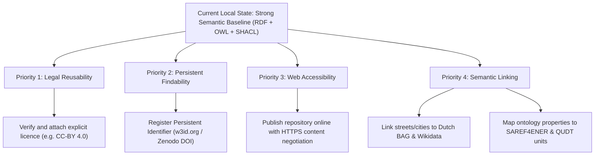

# FAIR Assessment Report: Dutch Electricity Dataset (Coteq 2013)

**Assessment Date**: 2026-10-24  
**Evaluator**: FAIR Data Assistant  
**Dataset Target**: `rdf/coteq_electricity_2013_csv (1).ttl`  
**Ontology Target**: `ontology/dutch_electricity_ontology.owx`  
**Metadata Target**: `reports/dataset_metadata.ttl`  
**Validation Target**: `reports/shacl_validation_report.txt`  

---

## Executive Summary

This assessment evaluates the degree to which the Coteq Electricity 2013 semantic dataset complies with the **FAIR Data Principles** (Findable, Accessible, Interoperable, Reusable). 

> [!NOTE]
> This assessment distinguishes between **completed verifications** based on concrete workspace evidence and **remaining gaps / recommendations**. The dataset is currently maintained in a local research workspace; therefore, it is **not yet publicly accessible or fully FAIR**. Significant progress has been achieved in semantic interoperability (RDF, OWL, and SHACL validation), while principal gaps remain in persistent identification, public web dereferencing, external authority linking, and formal licensing.

---

## 1. Findable

| Principle | Status | Implementation & Evidence | Remaining Gaps | Specific Next Actions |
| :--- | :--- | :--- | :--- | :--- |
| **F1: Persistent Identifier** | Partial | Placeholder URI `<http://example.org/dataset/coteq-electricity-2013>` assigned in [`reports/dataset_metadata.ttl`](file:///C:/Users/mahesh/Desktop/Dutch_Electricity_fair_project/reports/dataset_metadata.ttl). Local entity IRIs follow structured patterns (e.g. `coteq/record/...`). | `example.org` is a placeholder domain; no persistent identifier (DOI, ARK, or w3id.org PURL) is currently registered. | Register a persistent identifier (e.g. Zenodo DOI or w3id.org namespace redirect) upon repository publication. |
| **F2: Rich Metadata** | Complete (Local) | Created DCAT 2.0 and Dublin Core Terms metadata in [`reports/dataset_metadata.ttl`](file:///C:/Users/mahesh/Desktop/Dutch_Electricity_fair_project/reports/dataset_metadata.ttl) (84 triples) specifying title, description, temporal (2013), spatial coverage, theme, language, and distributions. | Primary publisher open data portal URL and initial CSV release date are unverified from source files. | Verify original publishing platform (e.g. data.overheid.nl or Coteq portal) and update `dcterms:publisher`. |
| **F3: Metadata Includes Identifier** | Complete | [`reports/dataset_metadata.ttl`](file:///C:/Users/mahesh/Desktop/Dutch_Electricity_fair_project/reports/dataset_metadata.ttl) explicitly states `dcterms:identifier` pointing to the dataset URI, and links directly to distributions. | Identifier is currently local/placeholder. | Replace placeholder URI with persistent URI once registered. |
| **F4: Searchable Resource** | Not Implemented | Files reside on local filesystem in `Dutch_Electricity_fair_project`. | Metadata is not indexed in any external search engine or dataset registry (e.g., Google Dataset Search, Datahub, Zenodo). | Deposit metadata in an open data repository or register in a CKAN catalog. |

---

## 2. Accessible

| Principle | Status | Implementation & Evidence | Remaining Gaps | Specific Next Actions |
| :--- | :--- | :--- | :--- | :--- |
| **A1: Retrievable via Standard Protocol** | Partial (Local only) | Data and metadata files are serialized in standard W3C Turtle (`text/turtle`) and XML formats, accessible via local file systems. | Not retrievable over standard internet protocols (HTTPS/HTTP). Local IRIs under `http://example.org/` do not dereference. | Deploy data and metadata to a web server or repository supporting HTTPS content negotiation. |
| **A1.1: Open, Free Protocol** | Planned | Target distribution protocol is HTTP/HTTPS. | Workspace files are currently local only. | Host on open infrastructure (e.g., GitHub Pages, Zenodo, institutional repository). |
| **A1.2: Authentication & Authorization** | Not Applicable / Open | Data consists of aggregated public utility consumption; no sensitive personal data or authentication requirements. | Formal open access statement not yet codified in repository policy. | Explicitly note open, unauthenticated access policy in publication landing page. |
| **A2: Persistent Metadata** | Complete (Design) | Metadata is completely decoupled from the data in [`reports/dataset_metadata.ttl`](file:///C:/Users/mahesh/Desktop/Dutch_Electricity_fair_project/reports/dataset_metadata.ttl). | Metadata persistence is only as durable as the local disk until deposited. | Ensure selected archive guarantees persistent metadata preservation even if data is archived/moved. |

---

## 3. Interoperable

| Principle | Status | Implementation & Evidence | Remaining Gaps | Specific Next Actions |
| :--- | :--- | :--- | :--- | :--- |
| **I1: Knowledge Representation Language** | Complete | Full RDF/Turtle representation ([`rdf/coteq_electricity_2013_csv (1).ttl`](file:///C:/Users/mahesh/Desktop/Dutch_Electricity_fair_project/rdf/coteq_electricity_2013_csv%20(1).ttl)) with 46,236 triples; formal OWL 2 ontology in [`ontology/dutch_electricity_ontology.owx`](file:///C:/Users/mahesh/Desktop/Dutch_Electricity_fair_project/ontology/dutch_electricity_ontology.owx); SHACL shapes in [`shacl/coteq_electricity_shapes.ttl`](file:///C:/Users/mahesh/Desktop/Dutch_Electricity_fair_project/shacl/coteq_electricity_shapes.ttl). | Classes and predicates belong to a custom domain namespace (`http://example.org/dutch-energy-ontology#`) rather than common international vocabularies. | Map domain concepts to standard energy vocabularies (e.g. SAREF, SAREF4ENER, Schema.org). |
| **I2: FAIR Vocabularies** | Partial | Metadata uses standard DCAT, Dublin Core Terms, and PROV-O. Domain ontology is modeled in OWL. | The custom ontology is not published with dereferenceable terms or registered in Linked Open Vocabularies (LOV). | Generate HTML documentation (e.g. with Widoco) and publish the ontology under a stable PURL namespace. |
| **I3: Qualified References** | Complete (Internal) / Partial (External) | Strong internal relational modeling: `EnergyRecord` links to `EnergyMeasurement`, `Location`, `Street`, and `NetworkManager`. Metadata links to ontology, shapes, and raw CSV. | Entities (streets, municipalities, postal codes) are not linked to external knowledge graphs like Dutch BAG (Basisregistratie Adressen en Gebouwen) or Wikidata. | Add `owl:sameAs` or `rdfs:seeAlso` links connecting municipalities and streets to Dutch BAG and Wikidata URIs. |

---

## 4. Reusable

| Principle | Status | Implementation & Evidence | Remaining Gaps | Specific Next Actions |
| :--- | :--- | :--- | :--- | :--- |
| **R1: Plurality of Relevant Attributes** | Complete | Data contains 2,503 records with granular metrics: connection count, active connections %, delivery %, low-tariff consumption %, smart meter %, and annual consumption. | Physical units of measurement (kWh) are not formally declared with unit ontologies (e.g., QUDT or OM). | Annotate energy measurement properties with unit references (e.g., `qudt:unit unit:KiloW-HR`). |
| **R1.1: Clear Data Licence** | **Critical Gap** | Explicitly documented as **Unverified / Unknown** in [`reports/dataset_metadata.ttl`](file:///C:/Users/mahesh/Desktop/Dutch_Electricity_fair_project/reports/dataset_metadata.ttl). A licence was **not** assumed without evidence. | Without an explicit, legally valid licence, third parties cannot legally reuse, redistribute, or build on the data. | Inquire with Coteq Netbeheer or source provider to determine exact licensing terms (e.g., CC-BY 4.0 or Open Data licence). |
| **R1.2: Detailed Provenance** | Substantial | Derivation path documented: `data/raw/coteq_electricity_2013.csv` $\rightarrow$ OpenRefine RDFTransform $\rightarrow$ `rdf/coteq_electricity_2013_csv (1).ttl`; modeling via Protégé; validation via pySHACL. | Transformation steps are preserved in JSON template but not serialized as a formal PROV-O activity graph. | Export formal PROV-O execution traces representing OpenRefine cleaning and transformation activities. |
| **R1.3: Community Standards Compliance** | Complete | Structural, datatype, cardinality, and SPARQL business rules validated using W3C SHACL ([`reports/shacl_validation_report.txt`](file:///C:/Users/mahesh/Desktop/Dutch_Electricity_fair_project/reports/shacl_validation_report.txt)). Conformance result: `True` (0 violations). | Data model is customized rather than conforming to IEC Common Information Model (CIM) or national energy data exchange standards. | Evaluate alignment with IEC 61968 / IEC 61970 standards for utility data exchanges. |

---

## 5. Summary & Action Plan

### Key Recommendations
1. **Clarify Licence (Highest Priority)**: Contact the data provider to confirm licensing terms.
2. **Assign Persistent Identifier**: Replace `http://example.org/` placeholders with permanent w3id.org PURLs or a Zenodo DOI.
3. **External Linking**: Enhance interoperability by linking Dutch postcodes and street names to official Dutch Kadaster BAG registries.
4. **Publish Documentation**: Generate HTML documentation for the ontology and host it publicly.
